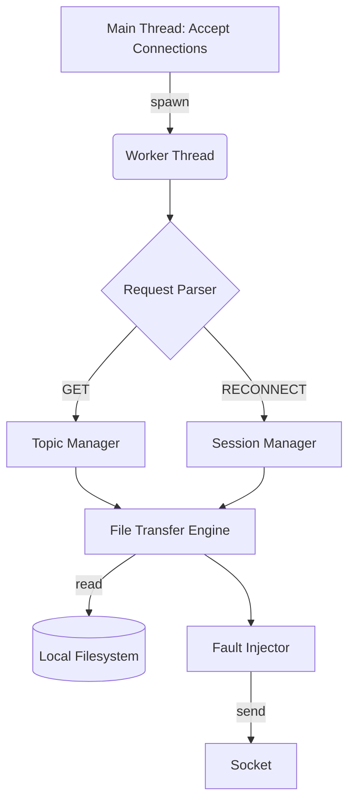
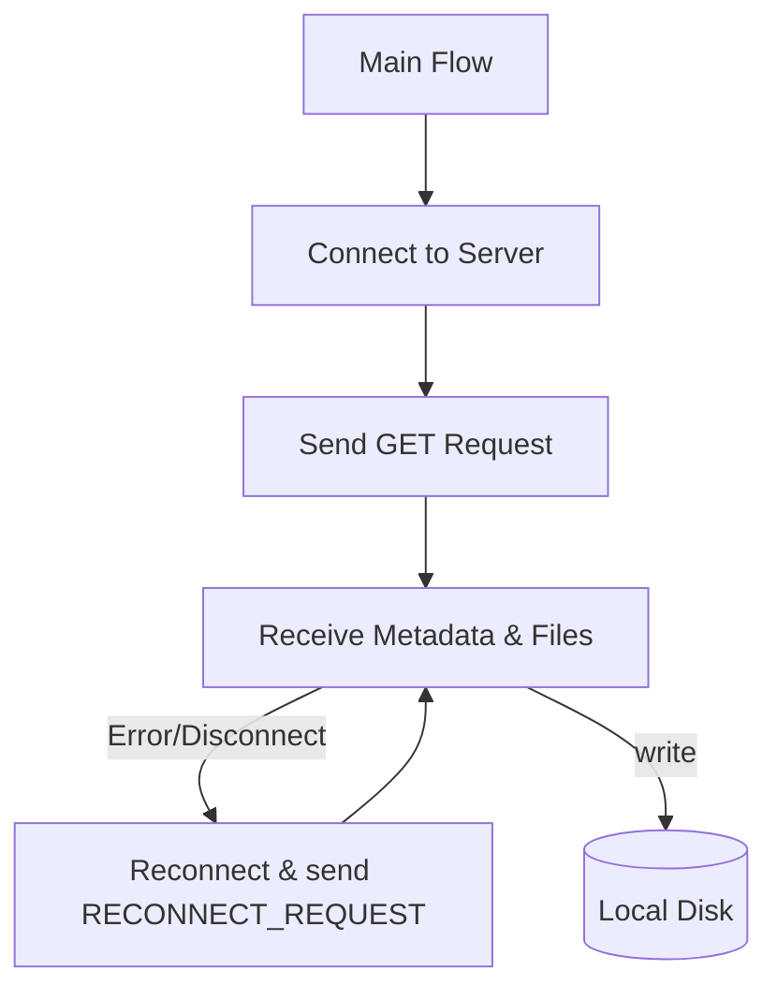

# System Architecture

## 1. Overall System Architecture
The system consists of a Server and a Client, communicating via TCP sockets.

### Components:
- **Socket Manager:** Handles socket creation, binding, listening, and connecting.
- **Protocol Manager:** Implements the application-layer framing (sending and receiving fixed headers + payload). Handles partial sends/receives.
- **Topic Manager:** Maps requested topics to physical directories and retrieves the list of files and their sizes.
- **Thread Manager:** (Server-side) Spawns a new POSIX pthread for each accepted client connection.
- **File Transfer Engine:** Opens files, reads chunks, and sends them over the network. On the client, receives chunks and writes them to disk.
- **Session Manager:** Tracks active sessions, stores file index and offsets.
- **Fault Injector:** Probabilistically closes the socket during file transfer to simulate network failure.

## 2. Server Architecture

## 3. Client Architecture

## 4. Multi-threading Model
The server uses a **One-Thread-Per-Client** model using POSIX pthreads.
- The main thread loops on `accept()`.
- Upon accept, a new thread is spawned, passing the client socket descriptor.
- Thread detach mode (`pthread_detach`) is used so resources are freed automatically when the client finishes, avoiding the need for `pthread_join`.
- Shared resources (like the global session map in Case 2) are protected by a `pthread_mutex_t`.

## 5. Fault Injection Mechanism
The command line specifies `<failure probability>` (e.g., `0.05` for 5%).
- Before sending each chunk, the server generates a random float between `0.0` and `1.0`.
- If `rand < failure probability`, the server explicitly calls `close(client_socket)`, logs `FAULT_INJECTED`, and exits the thread.
- This creates a realistic simulation of a dropped TCP connection.

## 6. Performance Enhancements (Case 2 Enhanced)
**OUR DESIGN DECISION:** Parallel TCP Connections.
Instead of a single thread transferring all files sequentially, the client will spawn $N$ threads, each establishing its own TCP connection.
The files within a topic will be distributed among the $N$ workers (e.g., worker 0 gets files 0, N, 2N... worker 1 gets 1, N+1, 2N+1...).
This will dramatically improve throughput over high-latency networks.
