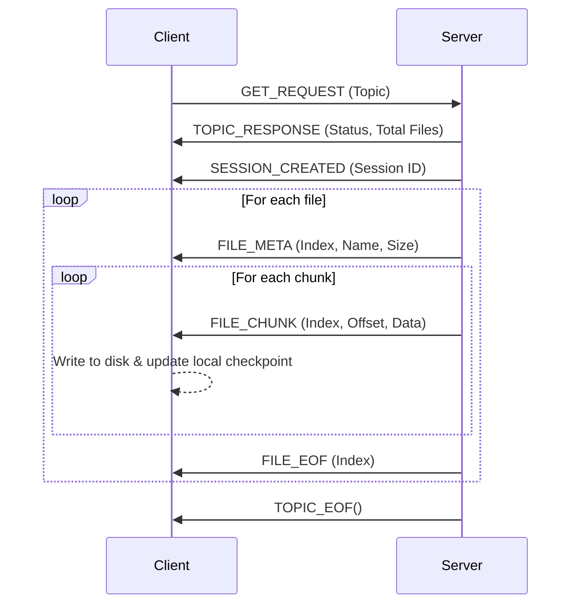
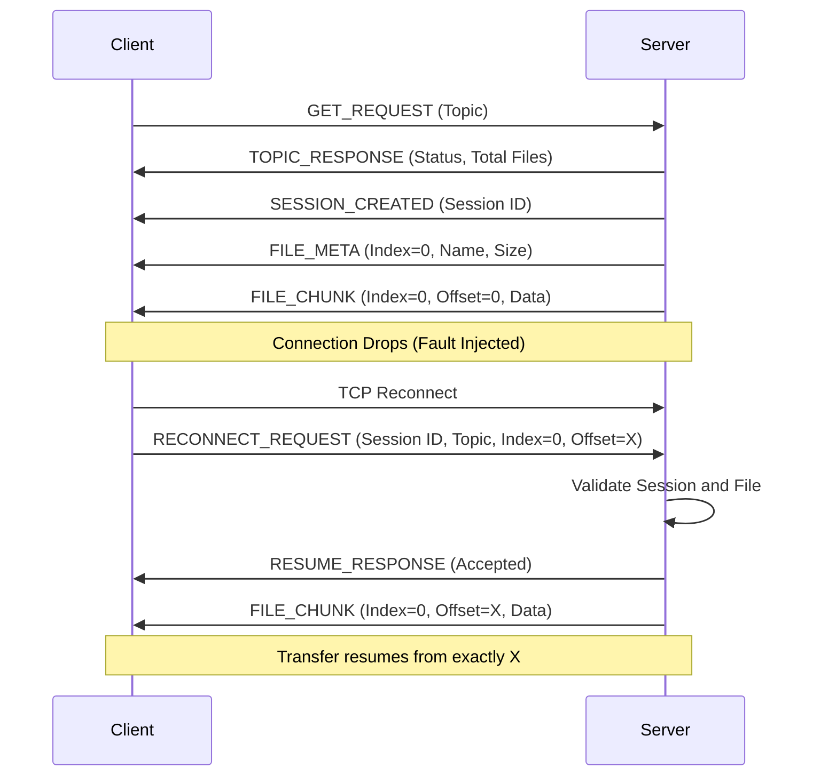

# Session Management Protocol (Case 2)

## 1. Overview
In Part II Case 2, the system must retain state to resume an interrupted transfer.
State can be maintained by the Server, the Client, or Both.

**OUR DESIGN DECISION:** 
The Client is the ultimate source of truth for how much data it has successfully written to disk. The Server assigns a Session ID initially. Upon a fault, the client reconnects, presents the Session ID, the Topic, and its own Checkpoint (which file it was downloading and how many bytes it successfully wrote). The Server validates this checkpoint and resumes sending from that exact offset.

This avoids edge cases where the server *thinks* it sent a chunk, but the client connection died before the chunk was written to disk.

## 2. State Maintained
**Client State (in memory):**
- Current Session ID (uint64_t)
- Topic (string)
- Current File Index (uint32_t)
- Current File Offset (uint64_t)

**Server State (in memory, mapped by Session ID):**
- Session ID
- Topic
- Total Files
- List of file sizes

## 3. Sequence Diagrams

### Normal Transfer

### Fault and Recovery

## 4. Checkpointing Strategy
The checkpoint is simply the logical position `(File Index, Byte Offset)` that the client has fully synced to its local disk. 
Since TCP ensures in-order delivery, the client updates its internal checkpoint variable after every successful `fwrite` to the local file.
When it reconnects, it simply checks the size of the partially downloaded file (or uses the memory variable) and sends that as the offset in `RECONNECT_REQUEST`.

## 5. Security & Validation
The server must validate the `RECONNECT_REQUEST`:
- Does the Session ID exist?
- Does the Topic match what was requested initially?
- Is `File Index < Total Files`?
- Is `Offset <= File Size`?
If any validation fails, the server sends `RESUME_RESPONSE (Rejected)` and the client must restart the transfer from scratch using `GET_REQUEST`.
